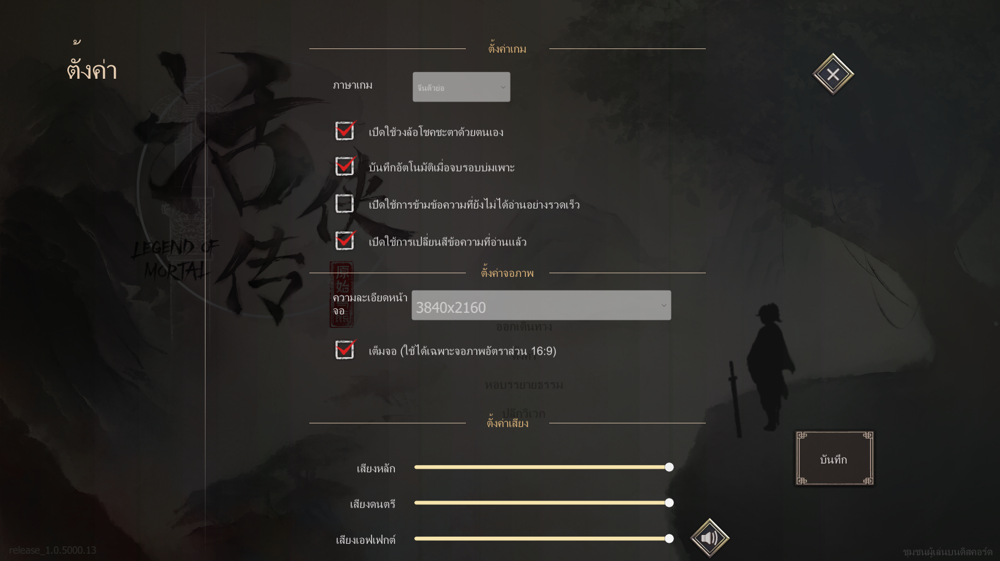

# LomThaiText — key-based translation injector (Solution 2)

A ~200-line BepInEx 5 plugin that writes Thai directly into the game's own
localization table, **keyed by the game's key** instead of by the Chinese text.

This is the architecture that removes the three hard ceilings of the
XUnity.AutoTranslator dictionary (`Mod/BepInEx/Translation/th/Text/Translation zh-CN to en.txt`):

| ceiling | why the dictionary can't | why this can |
|---|---|---|
| 12,761 keys share their text with another key (17%) | one text → one translation, forever | each key is translated independently |
| single-character values (`唐`, `修`, `出`) | `唐=ถัง` partial-substitutes into `三师兄`; 97 entries had to be commented out in v1.2 | no text matching happens at all |
| `.NET` format templates (`近战伤害{0:N0}`) | infinite rendered variants | one key covers every number |

It does **not** replace the dictionary — both run at once. The dictionary keeps
handling everything it already handles; this handles what it cannot reach.

## How it works

`Mortal.Core.LeanLocalizationResolver` proves every game string funnels through one call:

```csharp
public string GetString(string key) => LeanLocalization.GetTranslationText(key);
```

which reads `LeanLocalization.CurrentTranslations[key].Data` — a **public static**.
`UpdateTranslations()` wipes that table, calls `RegisterAndBuild()` on every
`LeanLocalization` instance (compiling the game's 130 `LeanLanguageCSV` sources),
and only *then* fires `OnLocalizationChanged`, which is what refreshes live UI text.

So the plugin puts a **Harmony postfix on `LeanLocalization.RegisterAndBuild`** — after
the game has written all of its own values, before anything reads them. That is
deterministic; relying on `LeanSource` registration order is not (a plugin registers
*before* the scene's own sources, so the game would win). A `LeanSource` subclass is
registered too, purely as a redundant second path.

No asset patching. No `Unity.Addressables.dll` patch. No DLL is modified.
Remove the folder and the game is byte-for-byte stock.

## Files

```
plugin/
  install.ps1                 build + copy into the live game (-Tsv <file>, -Uninstall)
  LomThaiText/
    LomThaiText.csproj        net472; references the game's Managed DLLs + BepInEx core
    Plugin.cs                 the whole plugin
    NotoSansThai-Regular-Adjusted.ttf
                              process-private Thai font used by legacy UGUI
    THIRD-PARTY-NOTICES.md    font and upstream license notices
    poc/Thai.tsv              the proof-of-concept probe set
```

Installed layout:
`BepInEx/plugins/LomThaiText/{LomThaiText.dll, Thai.tsv, NotoSansThai-Regular-Adjusted.ttf, THIRD-PARTY-NOTICES.md}`.

## Thai upper-vowel and tone-mark rendering

Unity 2020 legacy `UnityEngine.UI.Text` emits Thai combining marks without Thai
GSUB/GPOS positioning. In a cluster such as `ตั้`, the `ั` and `้` quads occupy the
same vertical band. Earlier C90/PUA substitution attempts were also unreliable in
this game: runtime mesh tracing showed the substituted `F714` and `F70A` glyphs
collapsing to tiny `2×2` baseline quads.

The plugin now keeps the real Unicode code points and patches
`Text.OnPopulateMesh` to raise only a tone mark that follows an upper vowel. A
standalone tone such as `่` in `ค่า` keeps the font's normal position. The fix was
confirmed in game for `ตั้งค่า`; the runtime trace recorded:

```text
codes=0E15 0E31 0E49 0E07 0E04 0E48 0E32
chars=8 visible=7 genVerts=28 meshVerts=28 indices=42
raisedStackedTones=1
```



## Thai.tsv format

`key<TAB>value`, UTF-8 **no BOM**, LF. `#` starts a comment line.
Escapes inside the value: `\n`, `\t`, `\\`. A literal TAB in a value is impossible —
use `\t`. (Same TSV hazard that truncated a key in v1.6.)

## Hotkeys (configurable in `BepInEx/config/com.krirk0137.lomthaitext.cfg`)

| key | effect |
|---|---|
| **F10** | re-read `Thai.tsv` and re-apply, without restarting the game |
| **F11** | dump the game's entire **live** key→text table to `BepInEx/LomThaiText_dump.tsv` |

The F11 dump is the ground truth for building the full file — it is what the game
actually has in memory, not what a ripped asset says it should have.

## Build

Needs the .NET SDK and an installed copy of the game (the reference DLLs are read
straight out of it).

```powershell
.\plugin\install.ps1                                  # default Steam path
.\plugin\install.ps1 -GameDir 'D:\Games\LegendOfMortal'
.\plugin\install.ps1 -Uninstall
```

## Status — ✅ PoC PROVEN in game (2026-07-21)

`poc/Thai.tsv` injects 11 probe keys chosen so that *nothing* in it could have come from
the dictionary. Confirmed on screen:

- the four title-screen buttons read Thai (`เริ่ม`, `หอธรรม`, `ลาจาก`)
- the Load Game panel reads **`ปีที่ 1 ต้นเดือนเมษายน`** — that is
  `System/GameTimeText = 第{0}年{1}{2}`, a `.NET` format template with unbounded
  rendered variants. One key covers every date in the game; the text-keyed dictionary
  could never match it.

`LomThaiText_dump.tsv` (72,560 live keys) is written on first launch — the game's own
table straight out of memory, and the ground truth for building the full file.

### The four dead ends this cost, so nobody repeats them

1. **Blank Thai is not always a font problem.** Legacy UGUI `Text` uses *dynamic* fonts,
   and Unity sources missing glyphs from the OS font fallback — `hasThaiGlyph=True` even
   on the Chinese brush font `DFT_S5`. Thai renders game-wide with `OverrideFont=` empty.
2. **It was the box.** A title label is `box=150x45` with `hOver=Wrap vOver=Truncate`,
   sized for two Chinese glyphs. The `[S2] ` marker added for visibility filled line one,
   the Thai wrapped to line two, and line two was clipped. The marker *was* the bug.
3. **The plugin's own `Update()` never runs in this game.** Anything time-based must live
   on a separate `DontDestroyOnLoad` object (`Ticker`), re-created from `Apply()`. Symptom:
   `Instance != null` returns false via Unity's fake-null, so config reads silently
   default. Never Unity-null-check the plugin component; capture config into plain statics.
4. **The TMP font asset is not named after its bundle.** `FallbackFontTextMeshPro=Kanit_sdf`
   loads an asset actually named `Kanit-Regular SDF`. Match on a fragment, not the filename.

### Sizing, for the full rollout

Title labels already have `bestFit=True`, but `resizeTextMinSize` is too high for long
Thai, so Unity wraps and clips instead of shrinking. Lowering the min size on labels the
plugin feeds handles the whole game at once; `Mod/BepInEx/Translation/th/Text/UI.resizer.txt`
remains available for per-path exceptions.
